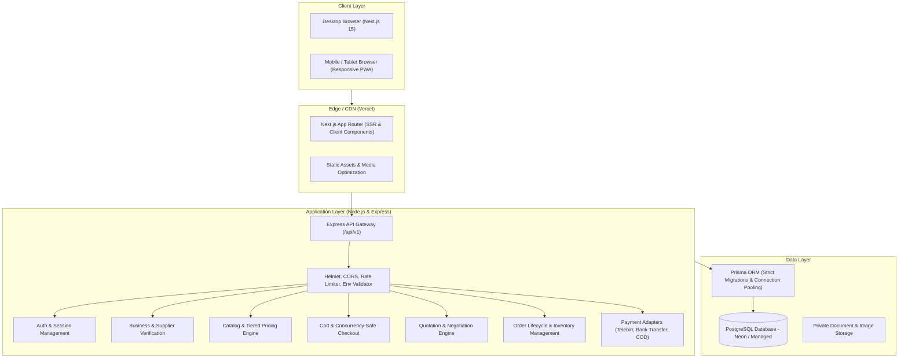

# WholesaleHub Ethiopia — System Architecture

## 1. Overview

WholesaleHub Ethiopia is a production-grade B2B wholesale marketplace designed for businesses in Ethiopia, starting with Addis Ababa. The platform connects manufacturers, importers, distributors, wholesalers, and retail buyers to facilitate wholesale discovery, transparent tiered pricing, bulk quotation requests (RFQ) with auditable negotiation, order management, and secure settlement.

## 2. High-Level Architecture Diagram

## 3. Technology Stack

- **Frontend:** Next.js 15 (App Router), React 19, TypeScript, Tailwind CSS, Lucide Icons.
- **Backend:** Node.js 24, Express, TypeScript, Zod for validation, Helmet, CORS.
- **Database & ORM:** PostgreSQL hosted on Neon / Managed Postgres, Prisma ORM.
- **Testing:** Vitest, Supertest for backend integration tests, Playwright for E2E.
- **Localization:** Ethiopia-first localization supporting English (`en`), Amharic (`am`), and Afaan Oromo (`om`).
- **Currency & Timezone:** Ethiopian Birr (ETB) with integer minor units / precise decimal representations; `Africa/Addis_Ababa` timezone.

## 4. Key Architectural Principles

1. **Separation of Concerns:** Strict decoupling between frontend client (`frontend/`) and backend REST API (`backend/`).
2. **Least Privilege Authorization:** Server-side role and ownership enforcement on every protected endpoint.
3. **Transactional Integrity:** Concurrency-safe inventory reservations, atomic checkout, and immutable order history snapshots.
4. **Resilient Local Market Adaptations:** Local payment workflows, regional address schemas (Addis Ababa sub-cities and woredas), and localized language support.
