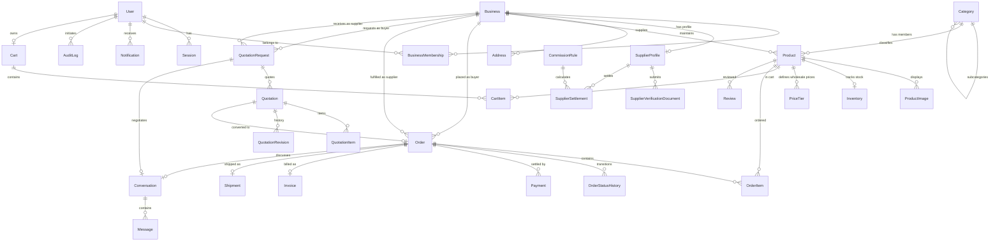

# WholesaleHub Ethiopia — Database Architecture & ER Diagram

## 1. Overview

The platform uses PostgreSQL with Prisma ORM. The schema is designed for multi-tenant B2B wholesale trade, ensuring strict data isolation between suppliers, concurrency-safe inventory tracking, tiered wholesale pricing, auditable RFQ negotiation histories, and immutable purchase snapshots.

## 2. Entity-Relationship Diagram (ERD)

## 3. Core Models & Business Rules

1. **User & Business Membership:**
   - Supports role-based (`BUYER`, `SUPPLIER`, `ADMIN`) and resource-based authorization.
   - Separation of personal credentials (`User`) and enterprise entities (`Business`).

2. **Supplier Verification:**
   - Real administrative approval workflow (`PENDING`, `APPROVED`, `REJECTED`, `SUSPENDED`).
   - Private storage and strict access controls for business licenses and tax certificates.

3. **Catalog & Wholesale Tiered Pricing:**
   - Each product defines a minimum order quantity (MOQ) and unit (carton, kg, box, etc.).
   - `PriceTier` records tiered discounts (e.g., 10-49 units @ 1400 ETB, 50+ units @ 1300 ETB).
   - Quantity tiers validate server-side and calculate line totals deterministically.

4. **Cart & Multi-Supplier Checkout:**
   - Carts can hold items from multiple suppliers, but checkout splits orders per supplier.
   - Concurrency-safe inventory reservations ensure no overselling.

5. **Quotations & Price Negotiation:**
   - Formal Request For Quotation (RFQ) cycle with target prices, expiry deadlines, and revision trails.
   - Immutable terms upon acceptance prevent retroactive changes.

6. **Order Snapshotting:**
   - Confirmed orders snapshot product names, SKUs, units, and unit prices to insulate historic financial records from future catalog changes.
